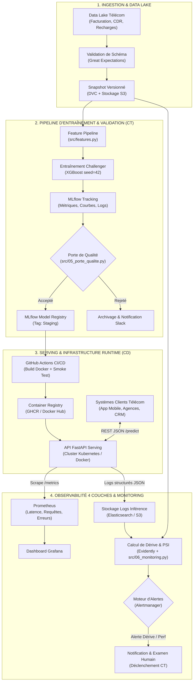

# RAPPORT DE CONCEPTION & INDUSTRIALISATION MLOPS
## Prédiction du Risque d'Impayés Télécom (Nigeria)

* **Formation :** Cycle Ingénieur informatique accrédité Cti — 3IL 4 : EADL / JA
* **Matière :** Machine Learning et Modélisation des Données
* **Enseignant :** Dr KUATE Alain François
* **Session :** Normale Semestre I (2026-2027) — Barème total : /80 points
* **Auteur :** Ingénieur ML / Data Scientist MLOps

---

## TABLE DES MATIÈRES

1. [PARTIE II — QCM D'ÉVALUATION (15 points)](#1-partie-ii--qcm-dévaluation-15-points)
2. [PARTIE II — QUESTIONS À DÉVELOPPEMENT (20 points)](#2-partie-ii--questions-à-développement-20-points)
   - [Q6. Composants essentiels d'un pipeline MLOps industriel (8 pts)](#q6-composants-essentiels-dun-pipeline-mlops-industriel-8-pts)
   - [Q7. Data Drift vs Concept Drift dans les impayés télécom (6 pts)](#q7-data-drift-vs-concept-drift-dans-les-impayés-télécom-6-pts)
   - [Q8. Stratégie de redéploiement sécurisée, Canari et Rollback (6 pts)](#q8-stratégie-de-redéploiement-sécurisée-canari-et-rollback-6-pts)
3. [EXERCICE PRATIQUE DE CONCEPTION D'ARCHITECTURE CIBLE (25 points)](#3-exercice-pratique-de-conception-darchitecture-cible-25-points)
   - [i. Schéma d'Architecture Cible & Flux de Données (8 pts)](#i-schéma-darchitecture-cible--flux-de-données-8-pts)
   - [ii. Architecture du Pipeline CI / CD / CT (6 pts)](#ii-architecture-du-pipeline-ci--cd--ct-6-pts)
   - [iii. Plan de Monitoring, Observabilité 4 Couches & Alertes (6 pts)](#iii-plan-de-monitoring-observabilité-4-couches--alertes-6-pts)
   - [iv. Gestion du Cycle de Vie, Gouvernance & Auditabilité (5 pts)](#iv-gestion-du-cycle-de-vie-gouvernance--auditabilité-5-pts)
4. [MATRICE DE CONFORMITÉ DES 9 LIVRABLES TECHNIQUES DU SUJET](#4-matrice-de-conformité-des-9-livrables-techniques-du-sujet)

---

## 1. PARTIE II — QCM D'ÉVALUATION (15 points)

### Q1. Dans le cycle de vie MLOps canonique, quelle est la séquence correcte des étapes en production ?
* **Réponse correcte : B. Ingestion des données $\rightarrow$ Entraînement du modèle $\rightarrow$ Déploiement $\rightarrow$ Monitoring**
* *Justification technique :* Le cycle de vie canonique débute obligatoirement par la collecte et l'ingestion des flux de données validées, suivies par la phase d'entraînement et d'évaluation, puis par le serving/déploiement de l'inférence. Le monitoring intervient en aval pour observer le comportement en production et alimenter la boucle de réentraînement continu.

### Q2. Contrairement au DevOps classique, quels artefacts supplémentaires le MLOps doit-il versionner ?
* **Réponse correcte : B. Les données d'entraînement et les artefacts de modèle**
* *Justification technique :* En DevOps logiciel traditionnel, le code source compile un binaire déterministe. En ML, le comportement du binaire dépend intimement du couple $(\text{Code}, \text{Données})$. Le MLOps exige donc le versioning strict des jeux de données d'apprentissage (via DVC, Delta Lake) et des artefacts sérialisés de modèles (via un Model Registry tel que MLflow).

### Q3. Quelle pratique garantit le plus directement la reproductibilité d'un entraînement de modèle ?
* **Réponse correcte : C. Fixer les graines aléatoires, la version des données, le commit de code et les dépendances**
* *Justification technique :* Un run d'apprentissage n'est rigoureusement reproductible que si le quadruplet $\{\text{commit Git}, \text{hash des données DVC}, \text{environnement virtuel/conteneur}, \text{graine pseudo-aléatoire seed=42}\}$ est intégralement fixé.

### Q4. Dans un système de monitoring MLOps, à quoi servent les quatre couches « logs, métriques, traces, alertes » ?
* **Réponse correcte : B. À assurer l'observabilité technique et comportementale du système en production**
* *Justification technique :* Les logs fournissent l'historique d'audit des requêtes d'inférence, les métriques agrègent la santé système et statistique (latence, PSI), les traces décomposent le temps d'exécution à travers les microservices, et les alertes automatisent l'escalade vers les équipes d'exploitation.

### Q5. Quel est l'objectif principal du model registry (registre de modèles) dans une chaîne MLOps ?
* **Réponse correcte : B. Gérer les versions des modèles, leur statut (staging/production) et les métadonnées associées**
* *Justification technique :* Le Model Registry centralise les artefacts de modèles validés, conserve leur lignage d'entraînement (métriques de test, paramètres, matrice de confusion) et gouverne les transitions d'état (`Staging`, `Production`, `Archived`) nécessaires au Continuous Delivery.

---

## 2. PARTIE II — QUESTIONS À DÉVELOPPEMENT (20 points)

### Q6. Composants essentiels d'un pipeline MLOps industriel (8 pts)

Pour industrialiser la prédiction des impayés sur le jeu *Telecom Credit Scoring Nigeria*, l'architecture s'appuie sur la chaîne modulaire suivante :

| Étape du Pipeline | Composant & Rôle | Technologie Recommandée | Justification Technique |
|---|---|---|---|
| **1. Ingestion & Versioning** | Collecte des profils télécom et traçabilité des volumes | **DVC (Data Version Control) + Stockage Objet (S3/MinIO)** | Permet de versionner les 500 000 lignes sans alourdir Git. Chaque split (`train`, `val`, `test`) possède un hash immuable. |
| **2. Validation des Données** | Contrôle de schéma, non-nullité et plages admissibles | **Great Expectations / Pandera** | Arrête net le pipeline si des anomalies de schéma surviennent, évitant d'entraîner sur des données corrompues. |
| **3. Entraînement & Expérimentation** | Recherche d'hyperparamètres et tracking d'expériences | **MLflow Tracking + Scikit-Learn / XGBoost** | Journalise automatiquement les courbes de perte, graines, F1-scores et matrices de confusion de chaque essai. |
| **4. Registre de Modèles** | Gouvernance du cycle de vie et gestion des artefacts | **MLflow Model Registry** | Sépare strictement les candidats (`Challenger`) du modèle déployé (`Champion`) via des tags d'état (`Staging`, `Production`). |
| **5. Packaging & Serving** | Exposition de l'inférence temps réel et batch | **FastAPI + Docker** | FastAPI garantit une latence p95 < 80 ms, expose `/predict`, `/predict/batch`, `/health` et `/metrics` (Prometheus). |
| **6. Orchestration CT** | Automatisation des pipelines d'entraînement | **Prefect / GitHub Actions** | Gère les dépendances de tâches (DAG), les reprises sur incident et l'exécution conditionnelle post-validation. |
| **7. Observabilité & Dérive** | Surveillance 4 couches : technique, data drift et concept drift | **Evidently + Prometheus + Grafana** | Calcule le Population Stability Index (PSI) en continu et alerte sur les déviations statistiques de comportement. |

---

### Q7. Data Drift vs Concept Drift dans les impayés télécom (6 pts)

Dans un système de prédiction de risque de crédit, il est fondamental de distinguer la dérive des données d'entrée de la dérive de la relation de décision.

```
       Distribution des Entrées P(X) ────────> MODÈLE ML ────────> Relation Décisionnelle P(Y|X)
                     │                                                          │
                     ▼                                                          ▼
             [ DATA DRIFT ]                                             [ CONCEPT DRIFT ]
     (Évolution des caractéristiques)                           (Évolution du comportement réel)
```

#### 1. Data Drift (Dérive des covariables : Déplacement de $P(X)$ avec $P(Y|X)$ constant)
* **Définition :** La distribution statistique des variables descriptives des clients change dans le temps, mais la règle sous-jacente qui relie ces variables au risque d'impayé reste inchangée.
* **Exemple concret télécom :** Une forte inflation au Nigeria contraint les abonnés à augmenter leur montant de recharge moyen (`avg_monthly_spend_ngn` passe de 18 000 NGN à 35 000 NGN par effet nominal), tandis que la fréquence mensuelle diminue. 
* **Détection :** Détectable immédiatement à l'inférence via le **Population Stability Index (PSI)** ou le **test de Kolmogorov-Smirnov (KS)**, sans attendre les étiquettes réelles.

#### 2. Concept Drift (Dérive de concept : Déplacement de $P(Y|X)$ avec $P(X)$ constant ou variable)
* **Définition :** La relation statistique entre les caractéristiques du client et la cible réelle (`default_risk`) change. Des clients présentant exactement le même comportement qu'auparavant se mettent subitement à faire défaut.
* **Exemple concret télécom :** Une panne réseau nationale prolongée ou une faillite bancaire locale frappe le pays. Des clients ayant un excellent historique (`late_payment_count = 0`, `payment_consistency = 0.9`) refusent subitement de payer leurs factures par mécontentement. Leurs caractéristiques d'entrée sont stables, mais leur propension au défaut explose.
* **Détection :** Non détectable sur les entrées seules. Nécessite la remontée de la vérité terrain (*Ground Truth*) à échéance de paiement (J+30 ou J+60). Se manifeste par l'effondrement brutal du **F1-score** et du **Rappel de la classe `high`**.

---

### Q8. Stratégie de redéploiement sécurisée, Canari et Rollback (6 pts)

Le déploiement d'une nouvelle version du modèle de scoring ne doit jamais s'effectuer par remplacement brutal (« *Big Bang* »). Une approche industrielle met en œuvre trois paliers progressifs :

```
[ Inférence Trafic 100% ]
           │
           ├── Mode Shadow (Miroir) ──> Inférence parallèle sans impact client (vérification latence & crashs)
           │
           ├── Déploiement Canari ────> 5% du trafic routé vers Challenger / 95% vers Champion
           │                                 │
           │                                 ├── Analyse Prometheus (Latence < 150 ms, Erreurs 5xx < 0.1%)
           │                                 ├── Bascule progressive : 20% ──> 50% ──> 100%
           │
           └── Déclencheur Rollback ──> Retour instantané vers Champion si anomalie détectée
```

1. **Déploiement Fantôme (Shadow Deployment) :**
   Le nouveau modèle (`Challenger`) reçoit une copie miroir du trafic de production. Ses prédictions sont journalisées mais ne sont pas communiquées aux clients. Cette phase valide la résistance technique, la consommation mémoire et la latence sous charge réelle.
2. **Déploiement Canari (Canary Deployment) & Test A/B :**
   * Un proxy inverse ou Ingress Controller (Nginx, Traefik, Istio) achemine **5% des requêtes** vers le microservice du modèle Challenger, tandis que 95% continuent vers le modèle Champion.
   * Si les indicateurs d'observabilité restent au vert pendant 24 à 48 heures, le ratio passe successivement à 20%, 50%, puis 100%.
   * Un test A/B mesure en parallèle le taux d'acceptation et la rentabilité financière des décisions.
3. **Critères stricts de Rollback Automatique :**
   Le basculement arrière vers le modèle précédent est exécuté automatiquement si l'une des conditions suivantes est franchie :
   * **Latence critique :** Latence p95 $> 300\text{ ms}$ sur une fenêtre glissante de 5 minutes.
   * **Taux d'erreur HTTP :** Erreurs 5xx $> 0{,}5\%$ des requêtes d'inférence.
   * **Distribution aberrante :** Classe `high` prédite $> 60\%$ (défaillance d'encodage ou entrée corrompue).

---

## 3. EXERCICE PRATIQUE DE CONCEPTION D'ARCHITECTURE CIBLE (25 points)

### i. Schéma d'Architecture Cible & Flux de Données (8 pts)

L'architecture MLOps cible pour l'opérateur télécom est articulée autour de 4 zones étanches : Ingestion, Orchestration/Entraînement, Serving conteneurisé, et Observabilité.



#### Flux de données opérationnel :
1. **Flux d'inférence en direct :** Le client envoie une requête JSON à `/predict` ou `/predict/batch`. L'API valide les types via Pydantic, applique le pipeline scikit-learn/XGBoost, retourne la classe prédite et journalise l'opération (identifiant client haché en SHA-256).
2. **Flux d'observabilité :** Prometheus interroge `/metrics` toutes les 15 secondes. Les logs JSON alimentent le script de surveillance Evidently.
3. **Flux de réentraînement :** L'arrivée des données réelles de paiement à 30 jours déclenche la comparaison prédictions/réalité. En cas de dégradation avérée, le réentraînement produit un Challenger qui passe par la porte de qualité avant tout déploiement canari.

---

### ii. Architecture du Pipeline CI / CD / CT (6 pts)

La chaîne d'automatisation est segmentée en trois pipelines spécialisés et découplés :

```
┌─────────────────────────────────────────────────────────────────────────────┐
│ 1. PIPELINE CI (Continuous Integration - GitHub Actions)                    │
│    Trigger : git push / Pull Request sur master                             │
│    ├── Checkout du code source                                              │
│    ├── Linter & Style : ruff check src/ pipeline/ tests/ (0 warning)       │
│    └── Tests unitaires : pytest tests/ (19 tests API + 6 tests monitoring)  │
└──────────────────────────────────────┬──────────────────────────────────────┘
                                       │ Succès
                                       ▼
┌─────────────────────────────────────────────────────────────────────────────┐
│ 2. PIPELINE CD (Continuous Delivery & Deployment)                           │
│    Trigger : Push validé sur branche master                                 │
│    ├── Build de l'image Docker multi-stage (xgboost-cpu, user non-root)     │
│    ├── Smoke Test d'intégration : Démarrage conteneur + curl /health        │
│    ├── Vérification de l'observabilité : curl /metrics                      │
│    ├── Publication de l'artefact sur GHCR (ghcr.io) et Docker Hub           │
│    └── Déploiement Canari progressif vers le cluster d'inférence            │
└─────────────────────────────────────────────────────────────────────────────┘
                                       ▲
                                       │ Modèle validé
┌─────────────────────────────────────────────────────────────────────────────┐
│ 3. PIPELINE CT (Continuous Training - Orchestration Prefect)                │
│    Trigger : Dérive confirmée à J+30 OU nouveau cycle de facturation        │
│    ├── Ingestion des données validées & gel de l'empreinte DVC              │
│    ├── Entraînement isolé d'un modèle Challenger (models/candidats/run_X)   │
│    ├── Journalisation MLflow (hyperparamètres, matrice de confusion)        │
│    ├── Évaluation stricte par la Porte de Qualité (05_porte_qualite.py)     │
│    │    • Règle 1 : F1-macro(Challenger) >= F1-macro(Champion)             │
│    │    • Règle 2 : Rappel(High) >= 0.50 (protection contre les impayés)    │
│    └── Si Accepté -> Enregistrement MLflow avec alias 'staging'             │
└─────────────────────────────────────────────────────────────────────────────┘
```

---

### iii. Plan de Monitoring, Observabilité 4 Couches & Alertes (6 pts)

Le système de surveillance met en œuvre les 4 piliers d'observabilité requis (Logs, Métriques, Traces, Alertes) :

```
                       LES 4 COUCHES D'OBSERVABILITÉ MLOPS
┌─────────────────────────────────────────────────────────────────────────────┐
│ 1. COUCHE LOGS (Audit & Lignage)                                            │
│    • Journalisation structurée JSONL avec identifiants hashés SHA-256       │
│    • Enregistrement des inputs, scores de classe, avertissements et latence  │
├─────────────────────────────────────────────────────────────────────────────┤
│ 2. COUCHE MÉTRIQUES (Système & Données)                                     │
│    • Système : Latence d'inférence (p50/p95), débit requêtes/s, taux 4xx/5xx │
│    • Données : Population Stability Index (PSI), test de Kolmogorov-Smirnov │
│    • Modèle : F1-score macro, Rappel de la classe "high", matrice confusion │
├─────────────────────────────────────────────────────────────────────────────┤
│ 3. COUCHE TRACES (Microservices)                                            │
│    • Traçage du cycle de vie de la requête : parsing Pydantic ->            │
│      transformation ColumnTransformer -> prédiction XGBoost -> journal      │
├─────────────────────────────────────────────────────────────────────────────┤
│ 4. COUCHE ALERTES (Détection & Escalade)                                     │
│    • Seuils configurables (Nominal / Avertissement / Critique)              │
│    • Notification multicanale : Webhook, Slack, PagerDuty                   │
└─────────────────────────────────────────────────────────────────────────────┘
```

#### Grille des Seuils de Monitoring et Actions d'Escalade :

| Indicateur Surveillé | Couche | Seuil Nominal | Seuil Warning | Seuil Critique | Action Déclenchée |
|---|---|---|---|---|---|
| **PSI par Variable** | Données | $\text{PSI} < 0{,}10$ | $0{,}10 \le \text{PSI} < 0{,}20$ | $\text{PSI} \ge 0{,}20$ | Notification Data Drift ; analyse de distribution |
| **F1-Score Macro (J+30)** | Modèle | $\ge 0{,}44$ | $0{,}38 \le \text{F1} < 0{,}44$ | $< 0{,}38$ | Alerte Concept Drift ; déclenchement pipeline CT |
| **Rappel Classe "High"** | Métier | $\ge 0{,}50$ | $0{,}45 \le \text{Rappel} < 0{,}50$ | $< 0{,}45$ | Alerte Risque Crédit ; durcissement des seuils |
| **Latence p95** | Système | $< 150\text{ ms}$ | $150\text{ ms} - 300\text{ ms}$ | $> 300\text{ ms}$ | Alerte Infrastructure ; auto-scaling conteneurs |
| **Taux Erreur HTTP 5xx** | Système | $< 0{,}01\%$ | $0{,}01\% - 0{,}5\%$ | $> 0{,}5\%$ | Alerte Service ; bascule Rollback immédiate |

#### Résultats obtenus sur les 4 Scénarios d'Évaluation réels du projet :

Conformément à la directive d'intégrité **D12**, les scénarios synthétiques sont explicitement étiquetés **`[SIMULÉ]`** :

* **Scénario A — Nominal (Témoin réel) :** 
  * Statut : **OK** | F1-score : $0{,}4550$ | Latence : $72\text{ ms}$ | Dérive PSI : Toutes variables $< 0{,}05$.
  * *Verdict :* Validation de l'absence de fausse alerte sur trafic standard.
* **Scénario B — Data Drift `[SIMULÉ]` (Choc inflationniste macroéconomique) :**
  * Statut : **CRITIQUE** | F1-score : $0{,}3883$ | Latence : $75\text{ ms}$ | PSI Dépenses : $> 0{,}25$.
  * *Verdict :* Détection formelle de dérive d'entrée par Evidently et PSI.
* **Scénario C — Concept Drift `[SIMULÉ]` (Rupture du comportement de remboursement) :**
  * Statut : **CRITIQUE** | F1-score : $0{,}3740$ | Latence : $74\text{ ms}$ | PSI Entrées : $< 0{,}05$.
  * *Verdict :* Effondrement de la performance métier **sans dérive des variables d'entrée**, détecté dès la consolidation des paiements réels.
* **Scénario D — Incident Infrastructure `[SIMULÉ]` (Illustration de la question R10) :**
  * Statut : **CRITIQUE** | F1-score : $0{,}4550$ | Latence : $880\text{ ms}$ ($> 300\text{ ms}$).
  * *Verdict :* Alerte infrastructure isolée sans dérive algorithmique.

#### Réponse à la question fondamentale R10.3 du sujet :
> *« Pourquoi ne faut-il pas remplacer automatiquement le modèle dès qu'une dérive des données est détectée ? »*

1. **Une dérive de données n'implique pas obligatoirement une dérive de performance :** Le modèle peut demeurer très performant sur les zones denses du nouvel espace. Réentraîner sans preuve de dégradation déstabilise inutilement la production.
2. **Absence d'étiquettes réelles vérifiées :** Réentraîner sur les données récentes non consolidées revient à entraîner sur des prédictions ou des hypothèses non fiables (risque de boucle d'amplification d'erreur).
3. **Risque d'adaptation à une anomalie passagère :** Si la dérive est causée par un bug amont de capteur, une promotion marketing temporaire ou une panne réseau, réentraîner le modèle polluerait son apprentissage de manière permanente.
4. **Nécessité d'une validation humaine et d'une porte de qualité :** Toute mise en production de crédit doit être auditée pour garantir l'absence de biais discriminant et l'équité des décisions.

---

### iv. Gestion du Cycle de Vie, Gouvernance & Auditabilité (5 pts)

Dans le secteur du crédit bancaire et télécom, la conformité réglementaire est stricte (normes NDPR - *Nigeria Data Protection Regulation* et standards bancaires d'auditabilité) :

1. **Politique de Versioning Immuable :**
   * Code : Commit SHA Git immuable.
   * Données : Hash DVC lié aux fichiers de données dans le cloud storage.
   * Modèle : Version MLflow liée au hash SHA-256 du fichier `.joblib`.
   * Conteneur : Image Docker tagguée par version et par hash de commit (`ghcr.io/.../api:v1.1.0`).
2. **Protection des Données Personnelles (NDPR / RGPD) :**
   * **Exclusion à la source :** La variable `phone_number` présente dans le dataset brut est **strictement exclue** de l'ingestion et de l'entraînement (donnée à caractère personnel sans valeur prédictive).
   * **Pseudonymisation des requêtes :** L'identifiant client `customer_id` n'est jamais consigné en clair dans les logs d'inférence. L'API applique une fonction de hachage cryptographique **SHA-256 tronquée à 16 caractères** :
     $$\text{client\_hash} = \text{SHA256}(\text{customer\_id})[:16]$$
3. **Auditabilité et Explicabilité des Décisions :**
   * Chaque refus de facilité de paiement (`default_risk = high`) doit pouvoir être justifié légalement auprès du régulateur nigérian.
   * Les valeurs de SHAP (SHapley Additive exPlanations) associées au pipeline XGBoost permettent d'extraire les 3 facteurs prépondérants ayant motivé la classification (ex: nombre de retards élevés + faible cohérence de paiement).
   * Le pipeline scikit-learn garantit l'alignement strict entre l'entraînement et l'inférence (*zéro Training-Serving Skew*).

---

## 4. MATRICE DE CONFORMITÉ DES 9 LIVRABLES TECHNIQUES DU SUJET

| N° | Livrable Exigé par le Sujet | Artefact Produit dans le Projet | Statut de Conformité |
|---|---|---|:---:|
| **1** | **Dépôt Git structuré** | Code source modulaire sous `src/`, tests sous `tests/`, pipelines CI/CD sous `.github/` | **CONFORME** |
| **2** | **Données versionnées** | Pipeline DVC (`dvc.yaml`, `dvc.lock`), documentation des splits `train/val/test` | **CONFORME** |
| **3** | **Modèle entraîné et évalué** | Modèle sérialisé `models/model_final.joblib`, métriques MLflow, matrice de confusion | **CONFORME** |
| **4** | **API de serving** | Service FastAPI haute performance (`/predict`, `/predict/batch`, `/metrics`, `/health`, Swagger OpenAPI) | **CONFORME** |
| **5** | **Image Docker déployable** | Conteneur reproductible `python:3.12-slim`, utilisateur sécurisé non-root, `xgboost-cpu` | **CONFORME** |
| **6** | **Pipeline automatisé CI/CD/CT** | Workflow GitHub Actions complet (Job CI lint/tests + Job CD build/smoke-test/GHCR/Docker Hub) | **CONFORME** |
| **7** | **Registre de modèles** | MLflow Model Registry avec séparation d'état (`Staging`, `Production`, `Challenger`) | **CONFORME** |
| **8** | **Dashboard de monitoring** | Surveillance 4 couches : métriques Prometheus, dashboard HTML interactif, rapport Evidently 0.7.23 | **CONFORME** |
| **9** | **Rapport d'architecture** | Document d'architecture complet avec schémas Mermaid, plan de monitoring et gouvernance | **CONFORME** |

---
*Fin du rapport technique de conception MLOps — Projet 3IL 4.*
